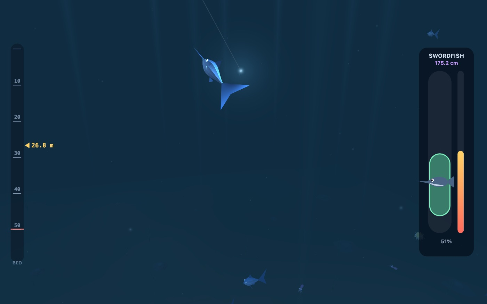
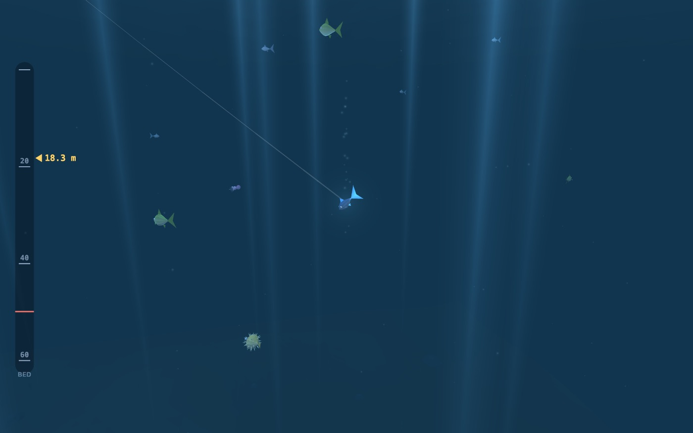
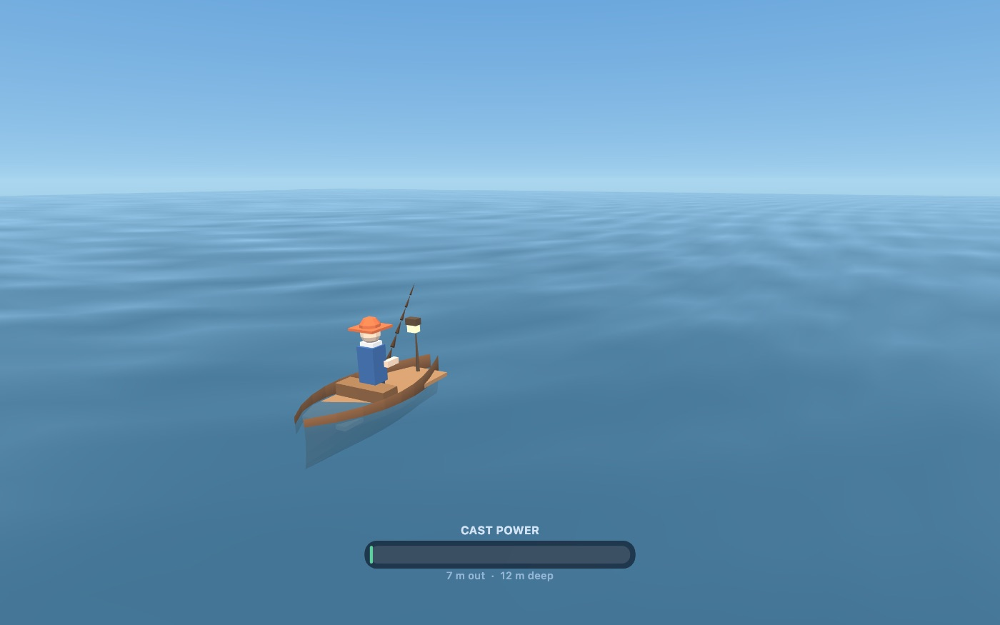
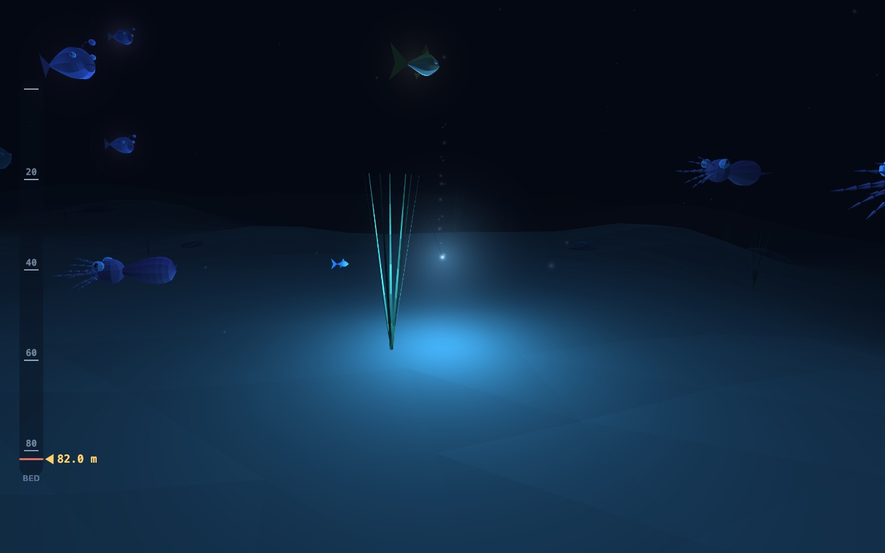

# Deep Blue

A small 3D fishing game that runs in a browser tab. Charge a cast, follow the
hook down through eighty metres of water, strike when something bites, then
fight it up to the boat. Sell the catch, buy better tackle, reach deeper water,
and fill the Fishdex.

**▶ Play: https://ctbot000.github.io/fishing-game/**



No build step, no dependencies, no network calls — plain HTML, CSS and ES
modules, rendered with hand-written WebGL 2. Every mesh in the game is generated
procedurally at load; there are no model files and no textures.

## Controls

| | Keyboard | Touch |
|---|---|---|
| Charge & cast | hold and release <kbd>Space</kbd> | press and release |
| Reel the hook back up | hold <kbd>Space</kbd> | press and hold |
| Steer the hook | <kbd>←</kbd> <kbd>→</kbd> or <kbd>A</kbd> <kbd>D</kbd> | drag, or the on-screen arrows |
| Strike a bite | <kbd>Space</kbd> | tap |
| Raise the fight bar | hold <kbd>Space</kbd> | press and hold |
| Shop / Fishdex / help | <kbd>S</kbd> / <kbd>F</kbd> / <kbd>H</kbd> | the buttons up top |

## How it plays





**Cast.** The power meter swings back and forth; release it where you want. A
stronger cast lands further out, where the seabed drops away — from 12 metres of
water close in to 84 metres at the end of the spool.

**Sink.** The hook falls on its own, down to whatever your line can reach, and
the camera goes with it. Every species lives in its own depth band, so where you
stop decides what you can catch. Some fish only come out after dark; the clock
runs a full day every two and a half minutes.

**Strike.** When `!` appears you have about a second. Miss it and the fish takes
the bait.

**Fight.** Hold to lift the bar, release to let it fall, and keep the fish inside
it to gain line. The fish pulls harder the closer it gets to the boat, and
harder still the longer the fight runs — so a long fight is a losing one. Let the
meter bottom out and it is gone.



**Upgrade.** Every catch sells on the spot. A longer rod widens the fight bar,
more line reaches deeper water, a geared reel gains line faster, and better bait
draws bites sooner and tempts rarer species. Twenty-two of them, from an anchovy
in the shallows to a golden koi eighty metres down at night.

**Junk is snagged, not tempted.** Boots, cans, tangled kelp and sunken chests sit
on the seabed. Put the hook on the bottom and drag it around.

Progress saves to `localStorage`. If the browser refuses to store it, the game
says so on the splash screen and plays fine for the session.

## Running it locally

Any static file server will do — ES modules will not load over `file://`.

```bash
python3 -m http.server 4173
```

Then open http://localhost:4173.

WebGL 2 is required. Without it the game says so plainly rather than showing a
blank canvas.

## Layout

```
index.html          markup: the two stacked canvases and the DOM panels
css/style.css       all styling; the overlay scales with the stage, not the viewport
js/config.js        tuning: species table, upgrade tracks, physics constants
js/game.js          simulation in metres — no DOM, no canvas, no WebGL
js/scene.js         the renderer: camera, lighting, fog, draw order
js/hud.js           the 2D overlay canvas: depth ruler, cast meter, fight panel
js/ui.js            HUD chips, shop, Fishdex, catch card
js/storage.js       save data, held in memory and written through to localStorage
js/audio.js         WebAudio blips, synthesised — no asset files
js/main.js          canvas sizing, the frame loop, the input funnel
js/gl/math.js       mat4 / vec3, only what one scene needs
js/gl/glutil.js     program, mesh and dynamic-buffer helpers
js/gl/shaders.js    the five GLSL programs: sky, lit, water, sprites, ribbons
js/gl/meshes.js     every mesh in the game, generated at load
```

### How the fish are made

One parametric builder covers most of the tank. A species declares a body
profile — height, width, snout, tail — and the builder lofts a chain of elliptical
rings along the nose-to-tail axis, caps the nose, and hangs a caudal, dorsal,
anal and two pectoral fins off it. Squid, jellyfish, rays, eels, anglerfish,
pufferfish and the junk items get their own builders. Everything is flat-shaded:
each triangle owns its three vertices so it can own its normal, which is what
gives the faceted look without a single texture.

Swimming is done in the vertex shader. Every creature is modelled nose-at-+x
spanning `x ∈ [-0.5, 0.5]`, so the shader can weight a lateral bend by distance
from the nose and drive the whole tank from one uniform.

### Notes from the build

Four things the code is deliberate about, because each one is a bug that only
shows up for some players — or only after you change renderer:

- **The palette is albedo, not paint.** Colours picked against flat 2D fills are
  final values. Fed through a lit renderer they get multiplied down by ambient,
  by `N·L`, and by depth fog, and the dark end of the palette disappears first.
  Every skin colour here was re-picked for the shading model, with nothing darker
  than about `#3a4658`.
- **Diffuse lighting is wrapped, not clamped.** A hard `max(dot(N,L), 0)`
  terminator leaves every face turned away from the sun unlit, and turning the
  lights up only clips the ones already bright. `(N·L + w) / (1 + w)` costs
  nothing and keeps the far side of a fish readable at eighty metres.
- **Time comes from the wall clock, never from a frame count.**
  `requestAnimationFrame` is throttled to a standstill in a hidden tab, so an
  effect retired after "120 frames" would freeze on screen instead of expiring.
  Every lifetime is a deadline in seconds, and the step is clamped so a long
  stall cannot teleport the simulation.
- **Storage is written through, not read back.** `localStorage` throws on every
  access in private-browsing modes and under blocked-cookie settings. The save
  object in memory is the source of truth, so a failed write costs persistence
  across reloads and nothing else.

Balance is checked by simulation rather than by feel: a headless run drives
thousands of casts with deliberately laggy, noisy controllers, and reports catch
rates, escape rates and fight lengths per gear level. The fight escalates its
drain with elapsed time and with progress, because a tug-of-war meter with
constant rates and no clock is always won by the patient player — the first
version had a 0% escape rate even for a bad one.

## Licence

MIT — see [LICENSE](LICENSE).
