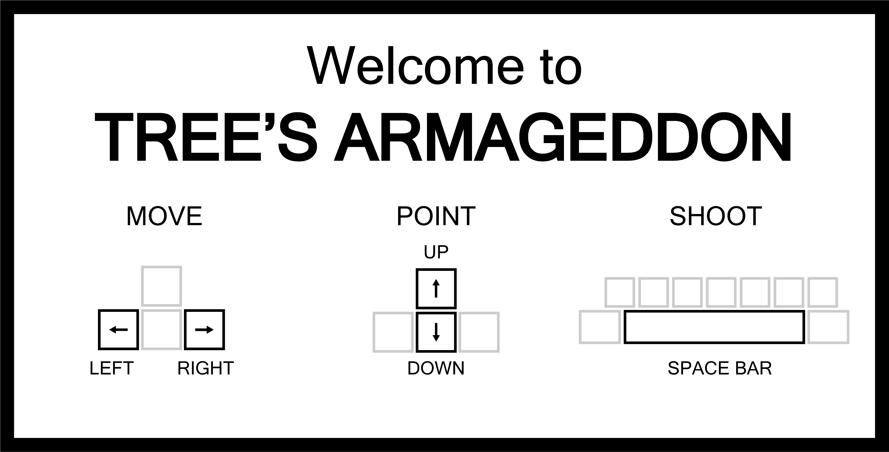

# Trees Armageddon

A turn-based artillery game in the browser, built with vanilla JavaScript and the Canvas API.
Two teams take turns; each turn a randomly chosen character fires. It takes at least three
hits to knock out an opponent.

**[Play it here](https://trees-armageddon.netlify.app/)** — sound on.



## How to play

- Each team fires once per turn, from a randomly selected character.
- Aim with angle and power, then fire.
- Three hits knock out an enemy. Last team standing wins.

## Run locally

No build step and no dependencies. Clone the repository and open `index.html` in a browser:

```bash
git clone https://github.com/am-santos/trees-armageddon.git
cd trees-armageddon
open index.html
```

## Built with

- Vanilla JavaScript, no framework
- HTML5 Canvas API for rendering, animation and collision detection
- CSS for the surrounding interface

## Context

My solo project from the Ironhack Web Development bootcamp, April 2020. It was the first
project of the course, built to practise the Canvas API and game loops. The other work from
that bootcamp is collected in
[ironhack-web-dev-bootcamp-2020](https://github.com/am-santos/ironhack-web-dev-bootcamp-2020).

## License

MIT — see [LICENSE](LICENSE).
